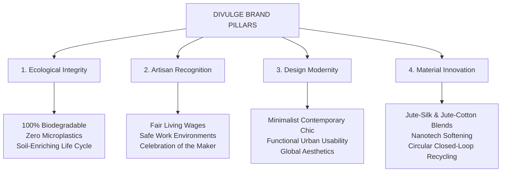

# DIVULGE Handicrafts - Brand Story & Strategic Guide

> **"The World will again know about this endangered treasure of India through the eyes of Divulge."**  
> — *Nilay Guha Roy, Founder & Proprietor, DIVULGE*

---

## 1. Brand Identity & Overview

| Element | Particulars |
|---|---|
| **Brand Name** | **DIVULGE** (also associated with sub-brand **AMATA**) |
| **Founder & Proprietor** | **Nilay Guha Roy** |
| **Industry / Domain** | Handcrafted Jute Lifestyle Products, Sustainable Home Living & Eco-Textiles |
| **Headquarters & Artisan Base** | West Bengal, India (Kolkata & Howrah craft clusters) |
| **Official Website URL** | `www.divulgejute.com` |
| **Legal Classification** | Micro-Enterprise (MSME Udyam) & Registered Exporter (DGFT) |
| **Trademark Status** | Registered Mark: `DIVULGE` (Cert. No. 2909685 / Application No. 5067640) |
| **Government Empanelments** | National Jute Board (NJB), Jute Corporation of India (JCI), Ministry of Textiles |

---

## 2. Brand Mission, Vision & Core Values

### Mission Statement
To rescue, elevate, and celebrate Bengal’s heritage "Golden Fibre" by designing contemporary, durable, and biodegradable handcrafted products that empower local artisan communities while eliminating plastic pollution from global daily life.

### Vision Statement
Divulge dreams of a flourishing, regenerative, greener world. As an authentic Indian brand, Divulge aims to be the global ambassador of handmade jute culture, proving that ecological responsibility and refined aesthetic luxury can coexist harmoniously.

### The 4 Core Pillars



---

## 3. Brand Story & The Artisan Narrative

### The Crisis of the "Golden Fibre"
For centuries, Bengal produced the finest jute on earth — strong, silky, and renewable. Yet, the advent of cheap petrochemical plastics and mass-machine synthetics pushed traditional jute cultivation and handloom weaving to the brink of obscurity. Skilled artisans and cultivators, despite possessing generational wisdom, were relegated to low-margin utilitarian bagging or forced out of their craft.

### The Divulge Intervention
Divulge was established by Nilay Guha Roy to transform jute from a coarse, overlooked packaging material into an elevated, desirable lifestyle choice. By introducing contemporary designs, precision finishing, and direct artisan partnership models, Divulge restores economic dignity to rural artisans.

### The People Behind the Products
- **Rural Craftswomen & Men:** Divulge actively engages women embroidery artisans and traditional loom weavers across Bengal villages.
- **Dignified Livelihoods:** Ensuring fair compensation, safe workshop standards, zero child labor, and continuous upskilling.
- **Cultural Conservation:** Documenting and preserving ancestral weaving techniques, intricate braiding, and hand-stitching traditions.

---

## 4. Product Ecosystem & Material Roadmap

### Current Core Collections
1. **Lifestyle Bags & Totes:** Urban shopping bags, minimalist canvas-jute totes, lunch bags, beach carriers, and laptop sleeves.
2. **Fashion & Daily Accessories:** Braided slings, cosmetic pouches, multi-purpose pouches, clutches.
3. **Home & Dining:** Coasters, table runners, dining mats, eco-planters, and braided storage baskets.
4. **Corporate & Event Gifting:** Customized sustainable gift bags, conference kits, and eco-packaging.

### Technical & Material Evolution Roadmap
- **Softened Jute Textiles:** Overcoming the natural stiffness of raw jute via eco-friendly softening and nanoparticle finishing for tactile comfort.
- **Multi-Fibre Blends (2025–2026):** R&D into proprietary hybrid yarns — Jute-Silk, Jute-Cotton, and Jute-Linen for luxury home decor and apparel.
- **Eco-Dyeing & Bleaching Unit:** Closed-loop, chemical-free vegetable and AZO-free dyeing systems.
- **Circular Recycling (2026+):** Post-consumer fiber re-spinning and zero-waste upcycling.

---

## 5. Statistical Proof: Jute vs. Plastic (The Ecological Economics)

Divulge’s research demonstrates clear mathematical justification for switching from plastic to jute:

```text
ECOLOGICAL ECONOMICS COMPARATIVE MATRIX (1 to 10 Scale)

Parameter              Jute (Divulge)    Plastic (Synthetics)
--------------------------------------------------------------
Initial Cost Benefit        3 / 10               8 / 10    (Plastic subsidized by fossil fuels)
Societal & Artisan Value    8 / 10               2 / 10    (Jute funds rural artisan families)
Ecological & Planet Value  10 / 10               1 / 10    (100% biodegradable vs 500-yr waste)
Disposal & Cleanup Cost     8 / 10               2 / 10    (Natural composting vs landfill crisis)
Ethical & Animal Safety    10 / 10               1 / 10    (Zero microplastics in food chain)
--------------------------------------------------------------
OVERALL WEIGHTED ADVANTAGE:  7.8 / 10            4.2 / 10  ==> JUTE WINS COMPREHENSIVELY
```

---

## 6. Official Registrations & Trust Architecture

The following certifications validate Divulge as a legitimate, compliant, and government-backed enterprise:

| Authority / License | Number / ID | Verification & Scope |
|---|---|---|
| **GST Registration** | `19AUJPG7653C1ZJ` | Active commercial trade registration |
| **DGFT (Import Export Code)** | `AUJPG7653C` | Authorized international global exporter |
| **MSME Udyam Certificate** | `UDYAM-WB-10-0013953` | Recognized Micro-Enterprise manufacturer |
| **Trademark Registration** | No. `2909685` (App `5067640`) | Proprietary trademark for "DIVULGE" |
| **National Jute Board (NJB)** | `NJB-09-JDP-20022025-951` | Registered Jute Diversified Products (JDP) unit |
| **Jute Corporation of India (JCI)** | Empanelled Partner | Verified raw jute and institutional partner |

---

## 7. Website Blueprint & Information Architecture Recommendations

When ideating and designing the official website, the following structure will maximize conversion and tell the brand story compellingly:

### Proposed Page Structure
1. **Home (`/`):**
   - **Hero:** Cinematic wide video/visual header showcasing raw golden jute transforming into modern designer lifestyle bags with headline: *"Earth-Kind Luxury, Woven by Bengal’s Artisans"*.
   - **Trust Banner:** Badges for NJB, JCI, MSME, DGFT Export Certified.
   - **Featured Collections:** Curated lifestyle bags, home decor, and corporate gifting.
   - **The Golden Fibre Advantage:** Interactive 5-point comparison (Jute vs. Plastic).
   - **Artisan Voice:** Video snippet or carousel of weavers at work with real artisan names and impact numbers.
   - **Newsletter / Eco-Pledge:** "Join 10,000+ conscious households replacing plastic."

2. **Our Story (`/story` or `/about`):**
   - The Founder’s journey (Nilay Guha Roy).
   - Meeting with Indian cultural doyen Rajiv Sethi and the inception of the mission.
   - Bengal’s heritage craft revival.
   - Transparent workshop ethics and fair artisan compensation.

3. **Collections & Shop (`/shop` or `/catalog`):**
   - Filter by: Lifestyle Bags, Everyday Totes, Home Living, Corporate Gifting.
   - Product detail pages with: Eco-impact score, Artisan credits, Material breakdown, Care instructions.

4. **Sustainability & Research (`/sustainability`):**
   - Lifecycle analysis: Carbon capture of jute crops (1 hectare absorbs ~15 tons of CO2).
   - Infographics on plastic reduction.
   - Innovation roadmap (Multi-fibre blends, nanotech softening, circular recycling).

5. **Journal & Editorial (`/blog`):**
   - Pre-loaded with the 8 converted long-form educational articles.

6. **Institutional & B2B Exports (`/export` or `/corporate`):**
   - High-volume custom corporate merchandise.
   - International export specifications (IEC AUJPG7653C certified).
   - Custom branding and screen/foil printing on jute.

7. **Legal & Compliance (`/policies`):**
   - Dedicated pages for Code of Conduct, Environmental Policy, Privacy Policy, Shipping, Return & Refund, Terms of Use, and Whistleblower Policy.

---

## 8. Directory Organization Reference

All source media and texts are permanently preserved and structured inside `assets/`:

- `assets/documents_md/`: 20 ready-to-use Markdown documents categorized into `brand_story`, `blogs`, `policies`, and `registrations`.
- `assets/images/`: 185 high-resolution images categorized into `brand_identity`, `artisan_craftsmanship`, `products_and_textures`, `founder_and_journey`, `sustainability_and_editorial`, and `embedded_doc_figures`.
- `assets/videos/`: 37 isolated video files categorized into `brand_and_motion`, `artisan_crafting`, and `journey_and_events`.
- `assets/ASSET_CATALOG.md`: Full resolution and placement index of every single image and video file.
