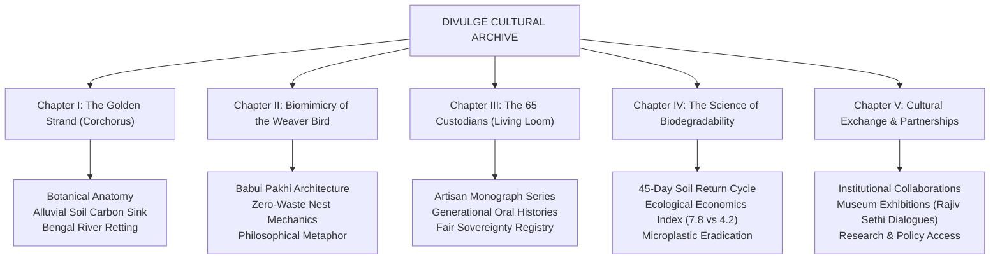

# DIVULGE — Cultural Pavilion & Ecological Knowledge Archive Specification

> **Positioning:** Sophisticated Non-Profit & Living Craft Archive  
> **Core Ethos:** Cultural Preservation, Biomimicry of the Weaver Bird, and the Planetary Science of Biodegradability  
> **Inspiration:** *The Loewe Craft Prize, Smithsonian Center for Folklife and Cultural Heritage, Asian Heritage Foundation (Rajiv Sethi), and Slow Factory Foundation.*

---

## 1. The Strategic Shift: From Commerce to Cultural Foundation

```text
❌ REJECT: E-COMMERCE STOREFRONT              VS.  ✅ EMBRACE: LIVING CULTURAL ARCHIVE
---------------------------------------------------------------------------------------------------------
"Add to Cart", discount codes, retail popups       "Explore the Monograph", "Inspect the Fiber Specimen"
Pushy product carousels & sales funnels            Curated field fieldnotes, loom audio-visuals, oral histories
Transactional consumerism                         Planetary stewardship, ecological economics, world heritage
Commodity bag selling                              Artisan dignity, biomimicry, cultural documentation
```

DIVULGE is presented as a **Cultural Research & Ecological Craft Pavilion** rooted in Bengal, dedicated to advancing a **world culture of natural biodegradability**. Products are not "items for sale" but **tangible artifacts of living knowledge, circular biomimicry, and rural artisan sovereignty**.

---

## 2. The 5 Curatorial Pillars & Page Chapters



---

## 3. Detailed Chapter Breakdown

### Chapter I: The Golden Strand (*Corchorus Olitorius*)
- **Theme:** Botanical and cultural origin of Bengal's indigenous fiber.
- **Content:** 
  - How 1 hectare of jute consumes **15 metric tons of CO2** and releases **11 tons of pure oxygen** within its 120-day growth cycle.
  - The sacred relationship between the Ganges delta, monsoon floodplains, and microbial water retting.
  - Archival photography of raw fiber harvesting from our `assets/images/founder_and_journey/`.
- **Aesthetic:** Herbarium specimen pressings, handwritten field notes, botanical deckle paper borders.

### Chapter II: The Animal Soul — Biomimicry of the Weaver Bird (*Babui Pakhi*)
- **Theme:** Nature’s master artisan and the origin of circular zero-waste design.
- **Content:**
  - The architecture of the suspended woven nest: how the male Baya Weaver selects and interlocks individual blades of grass using intricate overhand and slip knots.
  - The philosophy of *"Nothing Wasted"* in nature: collecting dropped fibers and offcuts.
  - Cultural literary connections: Rabindranath Tagore and Bengal folk poetry celebrating the *Babui Pakhi*.
- **Aesthetic:** Vintage natural history lithograph / copperplate engraving of the weaver bird in its nest, paired with tactile audio/visual b-roll.

### Chapter III: The 65 Custodians (The Living Loom Collective)
- **Theme:** Honoring the women artisans not as "factory laborers", but as **master heritage custodians**.
- **Content:**
  - Profiles of rural craftswomen (e.g. Master Weaver *Sunita Devi*), their generational knotting methods, and village collectives.
  - The ethics of non-profit craft: wage transparency, health autonomy, and community schooling.
  - Real ultra-HD documentary photography from `assets/images/artisan_craftsmanship/` (`_DSC8134.JPG` to `_DSC8198.JPG`).
- **Aesthetic:** Archival portrait plates, kraft paper envelopes with ribbon ties, embossed seals of authenticity.

### Chapter IV: The Science of Biodegradability & Ecological Economics
- **Theme:** Rigorous empirical proof that natural plant fibers are humanity’s only sustainable path forward.
- **Content:**
  - **The 45-Day Soil Test:** Interactive time-lapse visualization showing a Divulge woven piece decomposing naturally into fertile humus, compared to a polypropylene bag persisting for 500+ years.
  - **The Divulge Ecological Economics Index:**
    - Initial Cost vs. True Lifecycle Cost.
    - Social value, ecological absorption, microplastic hazard elimination.
    - Quantitative score: **Jute (7.8 / 10)** vs **Plastic Synthetics (4.2 / 10)**.
- **Aesthetic:** Minimalist editorial data infographics, earthy terracotta/sage bar charts, scientific research citations from NIRJAFT and ICAR.

### Chapter V: Global Cultural Exchange & Research Initiatives
- **Theme:** Dialogue, education, exhibitions, and non-profit collaborations.
- **Content:**
  - The vision shared with design doyen **Rajiv Sethi** (Asian Heritage Foundation): elevating grassroots craft into world museums and institutional spaces.
  - Government and scientific empanelments: **National Jute Board (NJB)**, **ICAR-NIRJAFT**, **JCI**.
  - Open invitation for cultural partnerships, educational fellowships, sustainable design residencies, and ethical institutional orders (replacing synthetic corporate materials with zero-waste jute artifacts).
- **Aesthetic:** Formal institutional colophon, official verification seal stamps, clean research contact inquiry form.

---

## 4. Visual & Audio Sensory Direction (Non-Profit Cultural Elegance)

1. **Subtle Tactile Audio (Opt-in / Ambient):**
   - Delicate ambient wooden shuttle click-clack and loom pedal rhythm, soft breeze rustling jute reeds on the Ganges bank.
2. **Motion Graphics Tone:**
   - Slowness, grace, gravity. No frantic animations or flash sales.
   - Smooth paper-layer parallax, torn edges slowly revealing underlying woven textiles.
   - Elegant typography set in *Cormorant Garamond* and *Plus Jakarta Sans*.
3. **Palette of Dignity:**
   - Unbleached Linen `#F6F3EB`
   - Deep River Silt / Charcoal Olive `#232720`
   - Natural Golden Jute Strand `#C5A880`
   - Sun-baked Terracotta Clay `#C86D51`
   - Sacred Madder Stitch Red `#B82B2B`
   - Wetland Sage `#8A9A86`
