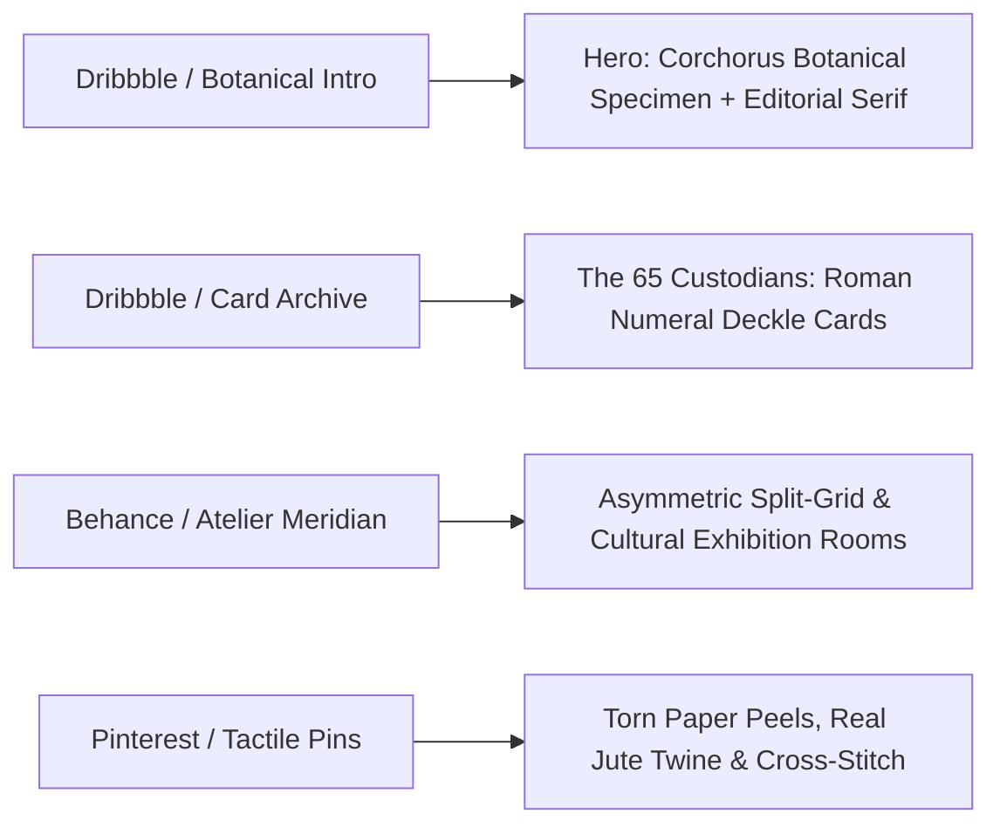

# DIVULGE — Design Benchmarks & Visual Research Synthesis

> **Research Sources:** Awwwards, Dribbble, Behance & Pinterest  
> **Aesthetic Profile:** Contemporary Botanical Herbarium, Museum-Grade Cultural Pavilion, and Living Craft Monograph Archive  
> **Saved Visual Captures:** Located in [`assets/moodboard/`](file:///g:/Code/CLIENTS/Divulge%20Handicrafts/assets/moodboard)

---

## 1. Key Architectural Benchmarks & Discoveries



### Benchmark 1: Botanical Exhibition Intro (*Dribbble*)
- **Screenshot:** [`botanical_exhibition_intro_1791575298817.png`](file:///g:/Code/CLIENTS/Divulge%20Handicrafts/assets/moodboard/botanical_exhibition_intro_1791575298817.png)
- **Key Pattern:** Large, graceful serif typography layered with an authentic botanical specimen illustration of the Jute plant (*Corchorus Olitorius*). 
- **Application to Divulge:**
  - Hero header: Centered editorial headline *"The Living Archive of Bengal's Golden Strand"* intersecting a detailed botanical etching of the jute stalk and flower.
  - Archival indexing metadata along the top border: `[CATALOGUE: DIV-2026] • [SPECIMEN: CORCHORUS OLITORIUS] • [HABITAT: GANGES ALLUVIAL DELTA] • [BIODEGRADABILITY: 100% ORGANIC]`.

### Benchmark 2: Card Archive Micro-Interaction (*Dribbble*)
- **Screenshot:** [`card_archive_interaction_1791575275905.png`](file:///g:/Code/CLIENTS/Divulge%20Handicrafts/assets/moodboard/card_archive_interaction_1791575275905.png)
- **Key Pattern:** Vertical tactile card deck indexed by numerals, revealing detailed monographs upon interaction.
- **Application to Divulge:**
  - **"The 65 Custodians":** An interactive card archive where each card represents one of the 65 rural craftswomen, indexed in Roman numerals (`Plate I` to `Plate LXV`).
  - Hovering lifts the card with a soft physical shadow, displaying the artisan’s village, loom technique, portrait from our `assets/images/artisan_craftsmanship/`, and oral quote.

### Benchmark 3: Atelier Meridian Art Gallery (*Behance*)
- **Screenshots:** [`behance_atelier_meridian_1791575333953.png`](file:///g:/Code/CLIENTS/Divulge%20Handicrafts/assets/moodboard/behance_atelier_meridian_1791575333953.png), [`behance_atelier_meridian_grid_1791575345256.png`](file:///g:/Code/CLIENTS/Divulge%20Handicrafts/assets/moodboard/behance_atelier_meridian_grid_1791575345256.png)
- **Key Pattern:** Asymmetric split-screen layout with generous negative space, high editorial polish, and museum curation tags.
- **Application to Divulge:**
  - The "Living Loom Exhibition Room": Left pane features an auto-looping silent video of traditional wooden handlooms in action (`assets/videos/artisan_crafting/weaving art.mp4`); right pane features an artisanal essay on the mathematical tension of the warp and weft.

### Benchmark 4: Ancient Art Exhibition Architecture (*Dribbble*)
- **Screenshot:** [`ancient_art_exhibition_1791575264817.png`](file:///g:/Code/CLIENTS/Divulge%20Handicrafts/assets/moodboard/ancient_art_exhibition_1791575264817.png)
- **Key Pattern:** Warm terracotta and ochre mineral backgrounds framing high-res physical artifacts, paired with restrained navigation and elegant chapter counters (`01/05`).
- **Application to Divulge:**
  - Section chapter numbering (`Chapter 01: Sowing the Silt` → `Chapter 02: The Weaver Bird's Nest` → `Chapter 03: The Handloom Sanctuary` → `Chapter 04: The 45-Day Soil Return`).

---

## 2. Synthesized Color Palette (The Earth & Mineral System)

```css
:root {
  --bg-parchment: #F7F4EE;         /* Base deckle paper background */
  --bg-card: #EFECE3;              /* Secondary warm archival card */
  --text-dark: #1F241E;            /* Deep forest charcoal (anti-black) */
  --text-muted: #5E6359;           /* Silt slate for descriptions & metadata */
  --accent-jute: #C5A880;          /* Golden raw jute thread */
  --accent-terracotta: #C85A32;    /* Bengal terracotta pottery clay */
  --accent-sage: #52796F;          /* Wetland botanical leaf sage */
  --accent-stitch: #B82B2B;        /* Traditional crimson madder thread */
  --border-delicate: #DFD9CE;      /* Subtle physical paper boundary line */
}
```

---

## 3. The 4 Interactive Motion & Storytelling Modules

### Module 1: The Interactive Bengal Weaving Cartography ("Geography of the Golden Silt")
- A stylized, minimalist SVG map of the Bengal delta showing historical weaving clusters (Howrah, Tangail, Nadia, Shantipur).
- Clicking a hub reveals the specific micro-climate, river floodplains, and the specialized knotting style mastered by local women artisans.

### Module 2: The Weaver Bird Biomimicry Showcase
- Interactive side-by-side comparison between:
  1. The **Baya Weaver Bird’s nest architecture** (interlocking grass blades, teardrop load suspension).
  2. Divulge’s **zero-waste braided jute structure** (upcycled remnant micro-twine, high tensile strength).

### Module 3: The 45-Day Biodegradation Empirical Time-Lapse
- An interactive slider where users drag from `Day 0` to `Day 45`:
  - **Jute:** Softens at Day 10 → breaks down via microbial digestion at Day 25 → dissolves into rich soil humus at Day 45, fertilizing new plant growth.
  - **Synthetic Plastic:** Persists unaltered at Day 45, Year 5, Year 50, and Year 500, fragmenting into hazardous microplastics.

### Module 4: The Curatorial Monograph Archive
- 3D tactile card interaction where visitors can inspect individual handcrafted pieces not with commercial price tags, but with **material specifications, hours of artisan handloom labor, CO₂ sequestration count, and artisan signature**.
